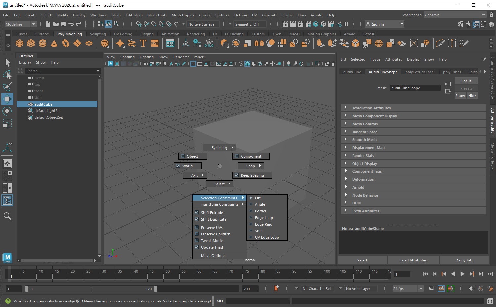
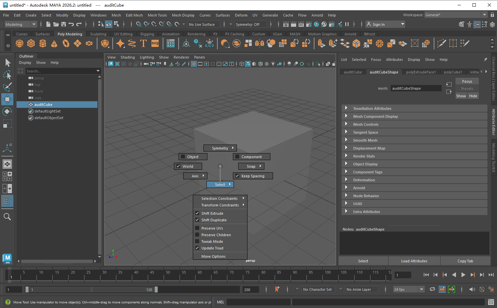
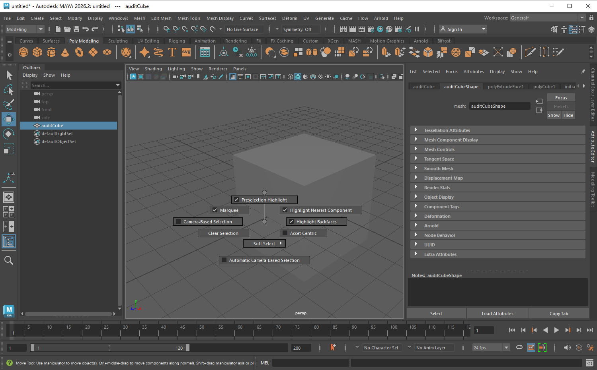

# MWK 可迁移部分与 Maya 原生核对

日期：2026-11-24。状态：**筛选与有限原生核对完成；尚未迁移运行时代码。**

结论：优先采用径向子菜单的“快速穿过不误开、停留再展开”规则。其余适合借用目录对照和测试场景，不能整包替换 AxisMeld 热盒。目录相符不代表命令、参数窗口或释放/取消行为相同。

## 基线与证据范围

- MWK 固定为 [v0.22.0 对应提交](https://github.com/5hyuns/maya-workflow-kit-for-blender/tree/63e33723ad9e81fc79c94c424aa7cf2ee64daf24)，commit `63e33723ad9e81fc79c94c424aa7cf2ee64daf24`。16 份参考源码的 Git blob SHA 与远端一致；没有安装或执行 MWK。
- AxisMeld 筛选基线 `f7005023a1dafb34eaca5bd03e575d3e1f83cc97`，分支 `axismeld/phase-2a`。先查当前实现，未把已存在的多列、QWER 重唤、级联导航算成新能力。
- 实际打开本机 Maya 2026.2（EXE `26.2.0.2567`，API `20260200`），使用独立偏好目录和可丢弃立方体场景、`Maya_Default` 热键集。Modeling Toolkit 已加载，`useCustomMenuAndStatusLineItems=0`、`useSelTransformKeys=0`。
- 证据包括原生 MEL/API 路由、真实 Maya GUI 中的 Qt 合成输入、活动 popup 查询和应用窗口截图。**不是物理鼠标/键盘手感验收**。未打开用户生产场景，测试实例已关闭。
- 本批不改变下载版本、公开测试目录或人工结果。当前试用包仍是 `axismeld-2026.10.29-custom-property-preview`；CP/PN 等原待测项保持。

## 迁移筛选

| 候选 | Maya 核对结果 | 决策与最小范围 |
|---|---|---|
| 径向子菜单穿过/停留判定 | W 菜单从中心快速穿过南侧 Select 到下方列表，Select 子环未误开；另一次停留后展开 | **优先迁移规则与轨迹测试**。只控制径向子菜单何时打开，保留普通列表级联；不直接采用 MWK 的 100ms/2px 常量 |
| 持键与重复 LMB 事件处理 | Q/W/E/R 持键内，首次 LMB、松 LMB、再次 LMB 均可重唤；松工具键后临时菜单删除 | **只补异常输入测试**。Axis 已有重唤机制；没有依据给正常松键添加 MWK 的 120ms 防抖或 150ms OS 轮询兜底 |
| 菜单目录、方向与 Options 数据 | 10 个按下时场景，68 个径向槽位标签与方向一致；正文及可用性有差异 | **采用脱敏对照数据查漏**，以 Maya 原生记录为准；不搬整套 MWK 执行映射或显示标签作键的方案 |
| 级联导航栈 | 源码存在可借的父行回划、切换另一父行等测试；本次没有完成原生 Esc 和所有返回路径核对 | **只借测试场景，行为暂缓迁移**。不能把 MWK 的 Esc 退一级当作 Maya 事实 |
| 边界布局 | 原生菜单可越过编辑器边界；绘制窗口覆盖所在屏幕。尚无完整底边/四视图/DPI 矩阵 | **只借边界输入组合**。保留 Axis 的 18px、Views 净间隔、完整列表和无滚动规则，不替换布局器 |

源码入口：[MWK engine.py](https://github.com/5hyuns/maya-workflow-kit-for-blender/blob/63e33723ad9e81fc79c94c424aa7cf2ee64daf24/src/allset/marking/engine.py#L222)、[hotbox_engine.py](https://github.com/5hyuns/maya-workflow-kit-for-blender/blob/63e33723ad9e81fc79c94c424aa7cf2ee64daf24/src/allset/marking/hotbox_engine.py#L160)、[menus.py](https://github.com/5hyuns/maya-workflow-kit-for-blender/blob/63e33723ad9e81fc79c94c424aa7cf2ee64daf24/src/allset/marking/menus.py#L479)、[ring_fit.py](https://github.com/5hyuns/maya-workflow-kit-for-blender/blob/63e33723ad9e81fc79c94c424aa7cf2ee64daf24/src/allset/marking/ring_fit.py#L235)。

## 原生行为核对

### 1. 快速穿过与停留展开：方向相同，阈值未标定

W 热盒中心在截图坐标 `(664,502)`，南侧 Select 在约 `(664,557)`。LMB 持续按住，依次移动到 y=535、555、575、600；事件日志总间隔约 66ms。抵达下方 Selection Constraints 后，普通级联打开，Select 径向子环未展开。

重新打开 W 后移到 Select 并停留：移动后约 44.5ms、612.6ms 开始采集的两次快照，分别显示父环、Select 子环。这些时间来自采集函数入口，实际截图在菜单查询之后，不是截图精确时刻。截图和查询会阻塞事件循环，文件名中的 50ms/350ms 是请求调度时间，**不能据此声称 Maya 精确阈值是 350ms、612.6ms 或 MWK 的 100ms**。

Axis 当前 `view3d_axismeld_hotbox.cc:1563-1583,1753-1756` 在移动命中可用 Menu 时即可打开。这里存在值得改进的交互差异。建议最小改动是目标 ID、移动轨迹、停留时刻组成的小状态；先补穿过、停留、抖动、擦角等测试，再修改打开判定。仍须保留中心取消、缺席方向和灰项遮挡，不让新的停留逻辑改变普通列表。

### 2. QWER 重唤：同一规则已被原生验证

四组首次 LMB 和第二次 LMB 均观察到 `QmarkMenuView`；中间松 LMB 后窗口隐藏，但 `tempMM` 仍存在（Q/W/E/R 分别为 6/20/22/21 根记录）。最终释放工具键后，四组 `tool_done` 均记录 `tempMM=false`。

安装文件中的 `buildSelectMM.mel`、`buildTranslateMM.mel`、`buildRotateMM.mel`、`buildScaleMM.mel` 使用 button 1 临时 popup；`destroySTRSMarkingMenu.mel` 经 `MarkingMenuPopDown` 清理。这支持保留现有“持工具键反复 LMB”机制，不支持照搬第三方释放延迟。

### 3. 上下文与目录：相同和不同分别保留

| 按下时上下文 | 本次原生结果 |
|---|---|
| 无选择、空白处 RMB | 北 Complete Tool，南 Select All |
| 无选择、鼠标命中物体 RMB | 物体/组件选择环与物体正文菜单 |
| 已选物体、空白处 RMB | 与上一行相同的根目录，使用选中对象回退 |
| 无选择、空白处 Shift+RMB | 创建方向环与创建正文列表 |
| 选择物体后 Shift+RMB | 物体建模方向环与正文列表 |
| 选择面后 Shift+RMB | 面建模方向环与正文列表 |

加上 QWER 共 10 个场景，只比较对应活动 popup 的根层，共 306 条记录（含 61 个独立 Options、43 个分隔记录）。没有拿同一次 dump 中残留的其他 popup 填补目录。

重点差异：

- MWK 面菜单在 Smart Extrude 后额外放入 Smart Bevel；本次 Maya 2026.2 该上下文没有这一项。不能由一次快照推断所有 Maya 版本都没有它。
- W 的 Keep Spacing / Update Triad、E 的 Free Rotate 等在 Maya 根项启用，而 MWK 静态动作是 `None`。其余非空动作也未运行，不能据目录推定实际可用。
- Project Curve on mesh、Assign Invisible Faces 在 Maya 有独立 Options。MWK 虽声明 Options，但动作是 `None`，其 `menu_layout.py:151,179` 构造条件会排除参数格。因此 Axis 必须保留主动作与参数入口独立的能力模型。
- Mesh RMB 的动作顺序一致，但 MWK 比 Maya API 返回的根序列少 3 条分隔记录；API 记录数不等于屏幕上可见横线数。
- 创建菜单 Exit On Completion 为勾选且禁用。全部 radio 查询失败，数据保持未知；`checkBox=False` 也不能单凭该值断定该项没有复选框。

详见[逐项差异](../reference/2026-11-24-mwk-maya/catalog-comparison.md)及[脱敏机器可读目录](../reference/2026-11-24-mwk-maya/catalog.json)。本次只核对根层结构，未核对所有子目录、命令效果和 Undo。

## 不迁移及未确认部分

1. **不整体搬 MWK modal / Session / layout。** MWK 进入子菜单前关闭父热盒，Axis 有既定父热盒保留契约；本次未完成 Maya Space→File 的标题点按、拖动和父层生命周期核对，不能声称此处 Maya 已实测同一或不同。
2. **不替换行高和边界策略。** MWK 列表/方向/Options 为 22/21/16px，Axis 伴随列表/Options 为 18px，方向按钮保持原尺寸和 Views 实际净间隔。Axis 本来就有自动多列；“MWK 支持多列”不是新迁移收益。Maya 的 screen-level 菜单可跨编辑器，不能直接推成 Blender 区域内布局算法。
3. **Esc 暂无结论。** 发给 QmarkMenuView 的模拟 Escape 未产生预期关闭，但未证明经过物理按键相同的 Maya 热键路由。安装默认链是 `NameComAbort_Context → AbortCurrentTool → ctxAbort`，并非 `MarkingMenuPopDown` 的别名。不能写成“Maya 的 Esc 无效”或“Esc 一定退一级”。
4. **不将占位与近似算法冒充等价。** MWK 的主项/Options 共用 enabled、标签标识路径和 allset 动作不能覆盖 Axis 稳定 ID、双语边界、独立 Options、禁用原因与原生上下文。新增建模/Skin/Skeleton/UV 算法继续暂停。

本轮 Windows 输入工具发生传输中断；后续 File 夹具还遇到已删除 Qt 菜单包装对象、第三个隔离实例未显示预期热盒等问题，均未计作成功。早期部分释放落到错误收件控件而触发测试场景 AE/Extrude，故上下文目录只取按下时快照，不据其后状态宣称取消通过。清理使用已确认由本次创建的进程 ID 与命令行校验，不涉及用户生产实例。

## 交付与下一开发批边界

本报告、脱敏目录、三张审阅过的应用截图及[证据索引](../reference/2026-11-24-mwk-maya/evidence.json)随文档提交保存；原始完整回调、窗口/场景标识和诊断文件仅留本机研究目录。未发布第三方源码或 Autodesk 安装脚本。目录提取使用标准库 AST/JSON，不 import/exec MWK。

若进入下一开发批，先实现径向子菜单快穿/停留规则及针对性测试，再对既有 QWER/返回/灰项/Options 做回归；布局和 Esc 等未核实策略不混入这批。实现后另增稳定人工测试编号并更新网页，本次研究不提前勾选或创造“已修复”状态。

源码许可信息：MWK 标识 GPL-3.0-or-later，Axis 参考源码标识 GPL-2.0-or-later。今后若复制实际代码须保留作者与来源并检查许可要求；本次只保存研究结论和观测数据，未作代码集成或完整许可审查。
